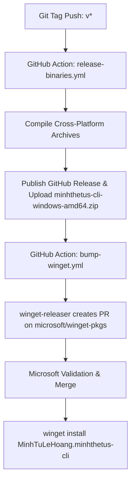

# WinGet Package Distribution Guide

This guide documents the architecture, setup, onboarding, and automation for distributing `minhthetus-cli` on Windows via **WinGet** (Windows Package Manager).

---

## 📌 Overview

WinGet package management for single Go binaries uses the `portable` installer type:
- **Download Artifact**: Pre-compiled `.zip` archive containing `minhthetus-cli.exe` (published on GitHub Releases).
- **Package Identifier**: `MinhTuLeHoang.minhthetus-cli`
- **Installation Path**: WinGet extracts the executable to `%LOCALAPPDATA%\Microsoft\WinGet\Packages\` and links it into the user's `PATH`.

---

## 🚀 CI/CD Automation Architecture



### 1. `.github/workflows/release-binaries.yml`
Automatically triggered whenever a release tag `v*` is pushed.
- Cross-compiles Go binaries for `windows/amd64`, `windows/arm64`, `darwin/arm64`, `darwin/amd64`, and `linux/amd64`.
- Zips the Windows executable as `minhthetus-cli-windows-amd64.zip`.
- Generates `checksums.txt` (SHA256).
- Creates or updates the GitHub Release and uploads all archives.

### 2. `.github/workflows/bump-winget.yml`
Automatically triggered when a GitHub Release is published (or manually via `workflow_dispatch`).
- Uses `vedantmgoyal2009/winget-releaser@v2` with `secrets.WINGET_TOKEN`.
- Automatically fetches the latest release zip, calculates SHA256, generates the updated manifest, and submits a PR to [microsoft/winget-pkgs](https://github.com/microsoft/winget-pkgs).

---

## 🔑 Required Repository Secret

To enable automated WinGet pull requests, add the following GitHub secret:
- **Secret Name**: `WINGET_TOKEN`
- **Type**: GitHub Personal Access Token (Classic)
- **Scopes**: `public_repo` (required to fork `microsoft/winget-pkgs` and submit PRs on your behalf).

---

## 🛠 One-Time Setup: First Package Submission

Before automated updates can run, the package identifier `MinhTuLeHoang.minhthetus-cli` must be initially submitted and accepted into `microsoft/winget-pkgs`.

### Step 1: Install `wingetcreate`
On a Windows terminal, install Microsoft's official manifest creation tool:
```powershell
winget install Microsoft.WingetCreate
```

### Step 2: Create and Submit the Initial Manifest
Once a GitHub release with `minhthetus-cli-windows-amd64.zip` is published (e.g. `v1.9.1`):
```powershell
wingetcreate new https://github.com/MinhTuLeHoang/minhthetus-cli/releases/download/v1.9.1/minhthetus-cli-windows-amd64.zip
```

### Step 3: Fill in Prompt Details
* **PackageIdentifier**: `MinhTuLeHoang.minhthetus-cli`
* **PackageVersion**: `1.9.1`
* **PackageName**: `minhthetus-cli`
* **Publisher**: `MinhTuLeHoang`
* **InstallerType**: `portable`
* **Commands**: `minhthetus-cli`
* **License**: `MIT`
* **ShortDescription**: `A professional, high-performance CLI tool for automation and developer productivity.`

`wingetcreate` will prompt for your GitHub Personal Access Token to submit the PR directly to `microsoft/winget-pkgs`. Once Microsoft's automated CI pipelines validate and merge the PR, the package is live.

---

## 🖥 User Commands

### Installation
```powershell
winget install MinhTuLeHoang.minhthetus-cli
```

### Upgrade
```powershell
winget upgrade MinhTuLeHoang.minhthetus-cli
```
*(Or via the CLI's native command: `minhthetus-cli update`)*

### Uninstallation
```powershell
winget uninstall MinhTuLeHoang.minhthetus-cli
```
*(Or via the CLI's native command: `minhthetus-cli uninstall`)*
